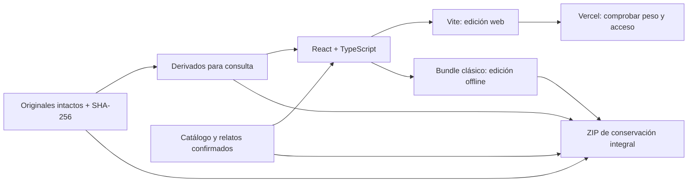

# Arquitectura propuesta — online y conservación offline

Fase de diseño. Base ya comprobable: React 19 + TypeScript + Vite, datos locales y recursos locales. Sin backend para el contenido de recuerdos. La maqueta no implementa aún todas las funciones del archivo.

## Dos entregas desde el mismo contenido



El catálogo será TypeScript/JSON versionado con IDs estables. Entidades: `Member`, `MediaAsset`, `Episode`, `GroomCase`, `Secret`, `ArchiveManifest`. Los medios conservarán ruta original, SHA-256, ruta derivada, dimensiones, orientación, fecha técnica y fecha editorial con estado `confirmed / approximate / unknown`. Una relación persona/medio tendrá fuente de confirmación; no se deducirá por reconocimiento facial. Separar el texto confirmado de la ficción gráfica.

Los datos se importan al bundle al construir. No usar `fetch()` para leer el catálogo en la edición `file://`. Fotos y vídeos usan rutas relativas. Navegación por hash o estado local, sin rutas que dependan de rewrites de servidor. La app no requiere persistir información para poder consultarse; favoritos/progreso serían mejoras optativas, con acceso a almacenamiento protegido y fallback en memoria.

## Offline duradero

Cambiar únicamente `base: './'` en Vite deja módulos ES que pueden fallar al abrir `file://`. La documentación de [Vite](https://vite.dev/guide/build#relative-base) cubre rutas relativas y [MDN](https://developer.mozilla.org/en-US/docs/Web/JavaScript/Guide/Modules#other_differences_between_modules_and_classic_scripts) explica las restricciones de módulos locales. Por eso existe una segunda compilación: **JS clásico IIFE, sin imports en tiempo de ejecución, sin carga dividida ni servidor**. En la maqueta, `scripts/build-offline.mjs` empaqueta React y sus dependencias con esbuild y copia fotos/fuente/CSS a una carpeta autocontenida.

Entrega final prevista:

```text
LOS-CERDAS-ARCHIVO/
  index.html                 # doble clic; web completa
  app.js + app.css            # bundles precompilados
  media/                     # JPEG/WebP + MP4 compatibles + pósters
  fonts/                     # tipografías y licencias locales
  originales/                # todos los archivos, bytes originales
  catalogo.json              # descripciones y relaciones legibles
  catalogo.csv               # alternativa sencilla para décadas después
  galeria.html               # catálogo estático de respaldo sin React
  fuentes/                   # fuente del proyecto + lockfile + instrucciones
  SHA256SUMS.txt              # originales y derivados, rutas relativas
  LEEME.txt                  # instrucciones humanas y formato de cada carpeta
```

El ZIP se genera en la fase de preparación, nunca comprimiendo cientos de MB en la memoria del navegador. La entrega debe probarse **después de extraer el ZIP**, en carpeta con espacios y otro nombre, sin red, sin caché previa y sin Node. Incluir prueba de controles de vídeo, audio, descarga individual y navegación de las ocho secciones. Los originales se pueden abrir por separado si el frontend deja de funcionar en un navegador futuro.

Conservar formatos comunes ayuda, pero ningún soporte garantiza décadas sin mantenimiento. Copia en disco del novio, otra copia independiente y comprobación periódica de hashes; migrar soporte/formatos cuando haga falta. Conservar siempre los originales además de las conversiones. Un service worker puede mejorar la consulta online después; no es la copia de conservación ni un requisito del ZIP.

## Medios y rendimiento

Generar derivados reproducibles sin modificar originales: WebP + JPEG, miniaturas según resolución real, MP4 H.264 / AAC con `faststart` y orientación normalizada. Mantener 29,97 fps y usar calidad medida; no convertir a 4K medios de baja resolución. Limpiar metadatos de ubicación de los derivados, no de los originales de conservación. Fotografías con `loading="lazy"`, dimensiones reservadas y visor sin filtros de grano. Vídeos con póster, `preload="none"`, `playsInline`, controles y sin autoplay. Música opcional local, pausada al reproducir vídeo.

## Hosting y descarga completa

Según documentación consultada el **10-10-2026**, [Vercel Hobby](https://vercel.com/docs/plans/hobby) ofrece uso personal gratuito y 100 GB de transferencia rápida incluidos. [La subida de fuentes por CLI está limitada a 100 MB](https://vercel.com/docs/limits#static-file-uploads). Este límite de CLI no equivale a un límite universal de tamaño total del archivo ni de salida de una compilación; la misma documentación indica que la salida no tiene ese límite de archivos. Revalidar condiciones antes de publicar.

Los originales actuales suman 168,7 MB, por lo que **no caben junto a la app en una subida CLI Hobby sin cambios**. Propuesta para la web: desplegar solo derivados y código, con presupuesto de 80 MB. Medir la conversión antes de confirmar gratuidad. Una visita que consume 25 MB supone aproximadamente 4.000 visitas dentro de 100 GB, sin contar solicitudes repetidas ni otros recursos; es una estimación de tráfico, no una promesa.

La **descarga integral con originales** es un artefacto aparte, previsiblemente mayor de 168 MB al añadir frontend y derivados. Debe entregarse localmente al novio aunque el alojamiento cambie. Para descargarla también desde la web hay que elegir un alojamiento compatible o un despliegue por Git/build que genere y sirva el ZIP, verificando límites reales, permisos y transferencia. También se pueden ofrecer paquetes de originales por separado con índice; dividir archivos no elimina el límite agregado de una subida CLI. No se propone un botón de descarga integral hasta que el paquete exista y sea accesible.

## Acceso y privacidad

El acceso «clasificado» de la maqueta es teatro. Un código comprobado en JavaScript o un easter egg no protege fotos públicas. Antes de publicar, decidir si toda la web requiere protección de despliegue o si hay dos catálogos: edición online seleccionada y entrega privada completa. Los medios exclusivos offline no deben viajar en el bundle online. No exponer originales con ubicación por defecto. El ZIP completo conserva originales deliberadamente para su propietario.

En esta fase no hay cuentas, autenticación, analytics, servicios externos en ejecución ni publicación. El audio solicitado ya se sirve desde un MP3 local y está incluido en el ZIP offline; procedencia y estado en `MUSICA.md`. La grabación fuente se conserva y verifica aparte del inventario de recuerdos.

## Orden de implementación después de la validación

1. Confirmar dirección artística y tono.
2. Cerrar textos reales, cronología, clasificación de medios y privacidad.
3. Preparar derivados y comprobar peso/calidad.
4. Implementar fichas, galería, vídeos, cronología y expediente Kili.
5. Incorporar sorpresas, audio autorizado y descarga integral real.
6. Construir y verificar ZIP completo offline; añadir respaldo estático y hashes.
7. Revisar con los tres amigos y el dispositivo de entrega; publicar la versión adecuada.

Criterio final de aceptación: mismo contenido autorizado disponible offline sin red; todos los originales conservados y verificables; ninguna sección vacía ni descarga ficticia; hechos confirmados y accesibilidad de teclado/móvil.
